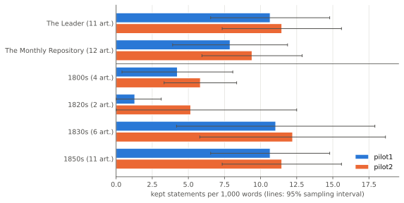
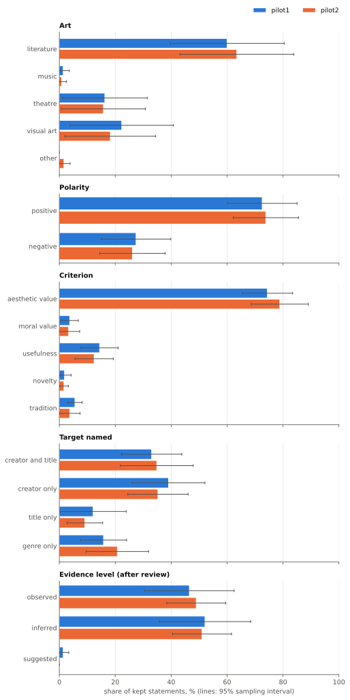
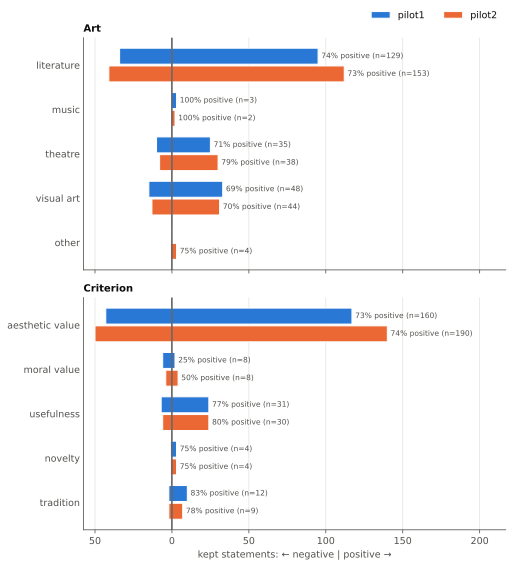
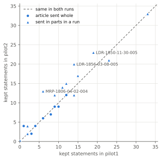
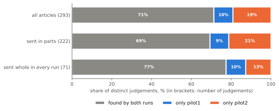
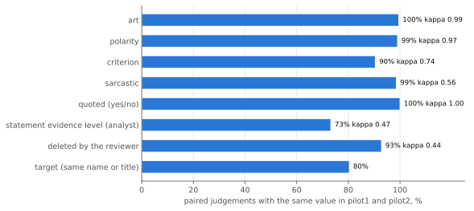
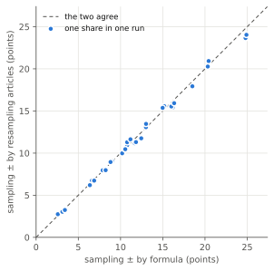

# Descriptive statistics — comparison of runs

Generated by `uv run ncse stats --datasets data/dataset/pilot-20261122 data/dataset/pilot-20261123 --labels pilot1 pilot2 --name pilots` (`src/ncse/stats.py`) from the assembled tables (stage 8). No LLM requests were made. *Kept* statements are those the reviewer did not delete; unless said otherwise, shares are shares of kept statements.

## 1. What is described

| run | dataset | model | analyst prompt | reviewer prompt | analysed on |
|---|---|---|---|---|---|
| pilot1 | `data/dataset/pilot-20261122` | jlu/qwen3.8-27b-fast | v1 (2c35cb8b8a00) | v2 (62ec31b5e663) | 2026-11-22 |
| pilot2 | `data/dataset/pilot-20261123` | jlu/qwen3.8-27b-fast | v2 (55f3ce4372df) | v2 (62ec31b5e663) | 2026-11-23 |

Only the 23 articles present in every run are compared.
Left out of pilot2: `LDR-1857-02-14-007` (not in every run).

**How to read the comparison columns.** *Runs differ by* is the gap between the highest and the lowest run. *Sampling ±* is the uncertainty that comes from having only these articles: another sample of the same size would give a share within about this many percentage points of the one found, 95 times in 100 (averaged over the runs). *Gap vs sampling* says whether the runs differ by more than that; for a value with fewer than 10 statements in every run it says *too few to say*. A gap smaller than the sampling uncertainty means that, at this sample size, the choice of articles matters more than the run; a larger gap means that the result depends on the run itself.

## At a glance

- **pilot1**: 237 statements in 23 articles, 215 kept by the reviewer (9.4 per 1,000 words); 156 (73%) positive.
- **pilot2**: 265 statements in 23 articles, 241 kept by the reviewer (10.5 per 1,000 words); 178 (74%) positive.
- **Shares** (sections 4, 6, 9): of 20 shares with enough statements, 20 differ between runs by less than their sampling uncertainty; the largest gap is 5 points (Target named: genre only, sampling ±10).
- **Single judgements** (section 8): of 293 distinct judgements, 209 (71%) were found by both pilot1 and pilot2, 28 (10%) only by pilot1, 56 (19%) only by pilot2. Where both found a judgement, they agree on polarity 99% (kappa 0.97), criterion 90% (kappa 0.74), statement evidence level 73% (kappa 0.47).
- **Sampling intervals** (section 10): resampling the articles gives intervals 0.98 times as wide as the formula (median).

## 2. Overview

|  | pilot1 | pilot2 | runs differ by |
|---|---|---|---|
| articles | 23 | 23 | 0 (0%) |
| words | 22903 | 22903 | 0 (0%) |
| articles with at least one kept statement | 21 | 21 | 0 (0%) |
| passages (quotations) | 138 | 163 | 25 (15%) |
| statements proposed by the analyst | 237 | 265 | 28 (11%) |
| statements deleted by the reviewer | 22 | 24 | 2 (8%) |
| statements kept | 215 | 241 | 26 (11%) |
| kept statements per 1,000 words | 9.4 | 10.5 | 1.1 (11%) |
| items set aside by the checks (failed_items.csv) | 1 | 1 | 0 (0%) |

## 3. Statements by periodical and decade

Kept statements, and kept statements per 1,000 words of the articles in that group.

### Periodical

| periodical | pilot1 | pilot2 |
|---|---|---|
| The Leader | 132 in 11 art. · 10.7 | 142 in 11 art. · 11.5 |
| The Monthly Repository | 83 in 12 art. · 7.9 | 99 in 12 art. · 9.4 |

### Decade

| decade | pilot1 | pilot2 |
|---|---|---|
| 1800s | 16 in 4 art. · 4.2 | 22 in 4 art. · 5.8 |
| 1820s | 1 in 2 art. · 1.3 | 4 in 2 art. · 5.2 |
| 1830s | 66 in 6 art. · 11.0 | 73 in 6 art. · 12.2 |
| 1850s | 132 in 11 art. · 10.7 | 142 in 11 art. · 11.5 |

Rate of kept statements per 1,000 words with its sampling uncertainty:

| run | per 1,000 words | sampling ± |
|---|---|---|
| pilot1 | 9.4 | ±3.0 |
| pilot2 | 10.5 | ±2.8 |

## 4. What the kept statements say

### Art

| value | pilot1 | pilot2 | runs differ by | sampling ± | bootstrap ± | gap vs sampling |
|---|---|---|---|---|---|---|
| literature | 129 (60%) | 153 (63%) | 3 points | ±20 | ±21 | smaller |
| music | 3 (1%) | 2 (1%) | 1 points | – | – | too few to say |
| theatre | 35 (16%) | 38 (16%) | 1 points | ±15 | ±15 | smaller |
| visual art | 48 (22%) | 44 (18%) | 4 points | ±17 | ±17 | smaller |
| other | 0 (0%) | 4 (2%) | 2 points | – | – | too few to say |

### Polarity

| value | pilot1 | pilot2 | runs differ by | sampling ± | bootstrap ± | gap vs sampling |
|---|---|---|---|---|---|---|
| positive | 156 (73%) | 178 (74%) | 1 points | ±12 | ±11 | smaller |
| negative | 59 (27%) | 63 (26%) | 1 points | ±12 | ±11 | smaller |

### Criterion

| value | pilot1 | pilot2 | runs differ by | sampling ± | bootstrap ± | gap vs sampling |
|---|---|---|---|---|---|---|
| aesthetic value | 160 (74%) | 190 (79%) | 4 points | ±10 | ±10 | smaller |
| moral value | 8 (4%) | 8 (3%) | 0 points | – | – | too few to say |
| usefulness | 31 (14%) | 30 (12%) | 2 points | ±7 | ±7 | smaller |
| novelty | 4 (2%) | 4 (2%) | 0 points | – | – | too few to say |
| tradition | 12 (6%) | 9 (4%) | 2 points | ±3 | ±3 | smaller |

### Sarcastic

| value | pilot1 | pilot2 | runs differ by | sampling ± | bootstrap ± | gap vs sampling |
|---|---|---|---|---|---|---|
| yes | 6 (3%) | 5 (2%) | 1 points | – | – | too few to say |
| no | 209 (97%) | 236 (98%) | 1 points | ±3 | ±3 | smaller |

### Quoted (someone else's opinion reported)

| value | pilot1 | pilot2 | runs differ by | sampling ± | bootstrap ± | gap vs sampling |
|---|---|---|---|---|---|---|
| yes | 23 (11%) | 27 (11%) | 1 points | ±8 | ±8 | smaller |
| no | 192 (89%) | 214 (89%) | 1 points | ±8 | ±8 | smaller |

### Target named

| value | pilot1 | pilot2 | runs differ by | sampling ± | bootstrap ± | gap vs sampling |
|---|---|---|---|---|---|---|
| creator and title | 71 (33%) | 84 (35%) | 2 points | ±12 | ±12 | smaller |
| creator only | 84 (39%) | 85 (35%) | 4 points | ±12 | ±12 | smaller |
| title only | 26 (12%) | 22 (9%) | 3 points | ±9 | ±9 | smaller |
| genre only | 34 (16%) | 50 (21%) | 5 points | ±10 | ±10 | smaller |

### Evidence level (after review)

| value | pilot1 | pilot2 | runs differ by | sampling ± | bootstrap ± | gap vs sampling |
|---|---|---|---|---|---|---|
| observed | 100 (47%) | 118 (49%) | 2 points | ±13 | ±13 | smaller |
| inferred | 112 (52%) | 123 (51%) | 1 points | ±13 | ±13 | smaller |
| suggested | 3 (1%) | 0 (0%) | 1 points | – | – | too few to say |

### Periodical

| value | pilot1 | pilot2 | runs differ by | sampling ± | bootstrap ± | gap vs sampling |
|---|---|---|---|---|---|---|
| The Leader | 132 (61%) | 142 (59%) | 2 points | ±25 | ±24 | smaller |
| The Monthly Repository | 83 (39%) | 99 (41%) | 2 points | ±25 | ±24 | smaller |

## 5. Combinations

### Share of positive judgements, by criterion and by art

Kept statements; *n* is the number of statements in the row.

| criterion | pilot1 | pilot2 |
|---|---|---|
| aesthetic value | 73% of 160 | 74% of 190 |
| moral value | 25% of 8 | 50% of 8 |
| usefulness | 77% of 31 | 80% of 30 |
| novelty | 75% of 4 | 75% of 4 |
| tradition | 83% of 12 | 78% of 9 |

| art | pilot1 | pilot2 |
|---|---|---|
| literature | 74% of 129 | 73% of 153 |
| music | 100% of 3 | 100% of 2 |
| theatre | 71% of 35 | 79% of 38 |
| visual art | 69% of 48 | 70% of 44 |
| other | – | 75% of 4 |

| periodical | pilot1 | pilot2 |
|---|---|---|
| The Leader | 65% of 132 | 68% of 142 |
| The Monthly Repository | 84% of 83 | 83% of 99 |

### Criterion by art (kept statements)

pilot1:

| art | aesthetic value | moral value | usefulness | novelty | tradition | total |
|---|---|---|---|---|---|---|
| literature | 86 | 5 | 28 | 1 | 9 | 129 |
| music | 1 |  |  | 2 |  | 3 |
| theatre | 30 | 3 |  | 1 | 1 | 35 |
| visual art | 43 |  | 3 |  | 2 | 48 |

pilot2:

| art | aesthetic value | moral value | usefulness | novelty | tradition | total |
|---|---|---|---|---|---|---|
| literature | 111 | 4 | 28 | 1 | 9 | 153 |
| music | 1 |  |  | 1 |  | 2 |
| theatre | 33 | 4 |  | 1 |  | 38 |
| visual art | 42 |  | 2 |  |  | 44 |
| other | 3 |  |  | 1 |  | 4 |

## 6. The reviewer

What the reviewer did with the analyst's statements: deleted whole statements, deleted single fields (creator, work title, genre), or lowered evidence levels (D-005).

|  | pilot1 | pilot2 | runs differ by |
|---|---|---|---|
| statements deleted | 22 | 24 | 2 (8%) |
| share of statements deleted (%) | 9.3 | 9.1 | 0.2 (2%) |
| creator: deleted | 1 | 1 | 0 (0%) |
| creator: downgraded | 3 | 0 | 3 (100%) |
| art: downgraded | 0 | 1 | 1 (100%) |
| work_title: deleted | 4 | 0 | 4 (100%) |
| work_genre: deleted | 0 | 1 | 1 (100%) |
| work_genre: downgraded | 0 | 1 | 1 (100%) |
| criterion: downgraded | 0 | 1 | 1 (100%) |

Evidence level of all statements, as the analyst gave it and after review:

| level | pilot1 | pilot2 |
|---|---|---|
| observed | 105 (44%) → 105 (44%) | 129 (49%) → 127 (48%) |
| inferred | 132 (56%) → 129 (54%) | 136 (51%) → 138 (52%) |
| suggested | 0 (0%) → 3 (1%) | 0 (0%) → 0 (0%) |

Share deleted: runs differ by 0 points; sampling ±3.

## 7. The same articles in different runs

Kept statements per article in each run (deleted ones in brackets). Articles sent in parts are marked with the number of parts in each run.

| article | words | pilot1 | pilot2 |
|---|---|---|---|
| `LDR-1850-11-30-005` | 1661 | 19 (3) | 23 (3) · 2 parts |
| `LDR-1851-05-17-011` | 536 | 3 (2) | 2 (3) |
| `LDR-1851-09-27-002` | 1458 | 12 (1) | 15 (0) · 2 parts |
| `LDR-1852-01-17-008` | 442 | 6 (0) | 6 (0) |
| `LDR-1852-06-05-001` | 1175 | 2 (0) | 4 (1) · 2 parts |
| `LDR-1852-06-05-008` | 1918 | 23 (3) | 21 (2) · 2 parts |
| `LDR-1854-06-24-002` | 655 | 4 (1) | 4 (0) |
| `LDR-1855-07-28-001` | 1302 | 33 (1) | 33 (3) · 2 parts |
| `LDR-1856-03-08-005` | 1144 | 14 (1) | 20 (2) · 2 parts |
| `LDR-1858-05-15-003` | 1068 | 2 (0) | 2 (1) · 2 parts |
| `LDR-1859-01-08-008` | 1021 | 14 (0) | 12 (0) · 2 parts |
| `MRP-1806-04-02-002` | 530 | 0 (0) | 0 (0) |
| `MRP-1806-04-02-004` | 2194 | 6 (1) | 13 (1) · 3 parts |
| `MRP-1808-09-02-001` | 718 | 8 (3) | 7 (1) |
| `MRP-1808-10-02-006` | 331 | 2 (0) | 2 (1) |
| `MRP-1822-03-02-001` | 494 | 1 (0) | 4 (0) |
| `MRP-1826-06-02-009` | 281 | 0 (0) | 0 (0) |
| `MRP-1830-03-02-002` | 475 | 10 (1) | 9 (1) |
| `MRP-1831-08-02-005` | 1403 | 9 (2) | 12 (0) · 2 parts |
| `MRP-1832-03-02-001` | 2259 | 11 (2) | 14 (1) · 3 parts |
| `MRP-1832-11-02-003` | 366 | 9 (0) | 9 (3) |
| `MRP-1837-08-01-006` | 292 | 12 (0) | 12 (0) |
| `MRP-1837-09-01-020` | 1180 | 15 (1) | 17 (1) · 2 parts |

pilot1 vs pilot2: correlation of kept statements per article 0.96; on average an article's count differs by 1.7 statements.

## 8. Do the runs find the same judgements?

Statements of two runs are paired when their evaluative expressions overlap in the same article (see `src/ncse/stats.py`, `match_statements`). A statement without a partner is a judgement that only one run found, or one that the two runs cut differently. All statements are paired, deleted ones included; the reviewer's decisions are compared afterwards.

### pilot1 and pilot2

|  | statements |
|---|---|
| in pilot1 | 237 |
| in pilot2 | 265 |
| found by both (pairs) | 209 (71%) |
| found only by pilot1 | 28 (10%) |
| found only by pilot2 | 56 (19%) |
| distinct judgements in all | 293 |

Of the statements of pilot1, 209 (88%) have a partner in pilot2; of those of pilot2, 209 (79%) have one in pilot1.

The same, separately for articles annotated in parts (D-034) and articles sent whole:

| articles | found by both | only pilot1 | only pilot2 |
|---|---|---|---|
| sent in parts in at least one run (12 articles) | 154 (69%) | 21 (9%) | 47 (21%) |
| sent whole in every run | 55 (77%) | 7 (10%) | 9 (13%) |

Kept statements (after review):

|  | pilot1 | pilot2 |
|---|---|---|
| kept | 215 | 241 |
| … and kept in the other run too | 187 (87%) | 187 (78%) |
| … found in the other run but deleted there | 9 (4%) | 6 (2%) |
| … not found in the other run | 19 (9%) | 48 (20%) |

Agreement on the paired statements. *Same* is the share of pairs with the same value; *kappa* corrects it for the agreement two runs would reach by chance with these proportions (1 = always the same, 0 = no better than chance; above about 0.6 is usually called substantial, below 0.4 weak).

| field | same | kappa |
|---|---|---|
| art | 208 (100%) | 0.99 |
| polarity | 207 (99%) | 0.97 |
| criterion | 189 (90%) | 0.74 |
| sarcastic | 206 (99%) | 0.56 |
| quoted (yes/no) | 209 (100%) | 1.00 |
| statement evidence level (analyst) | 153 (73%) | 0.47 |
| deleted by the reviewer | 194 (93%) | 0.44 |
| target (same creator or title, written alike) | 168 (80%) | – |

Criterion in the paired statements (rows: pilot1; columns: pilot2):

| pilot1 \ pilot2 | aesthetic value | moral value | usefulness | novelty | tradition |
|---|---|---|---|---|---|
| aesthetic value | 153 |  | 2 | 1 | 3 |
| moral value | 2 | 5 |  |  |  |
| usefulness | 6 |  | 21 |  |  |
| novelty |  |  |  | 3 |  |
| tradition | 6 |  |  |  | 7 |

Examples of judgements found only by pilot1 (first 8 kept ones, in article order):

- `LDR-1850-11-30-005-p01-s01` “so much has been done by scholars for the elucidation of his text” — positive, usefulness
- `LDR-1850-11-30-005-p02-s02` “alchemical claims” — negative, usefulness
- `LDR-1850-11-30-005-p05-s01` “(a German wit, observe!)” — negative, aesthetic value
- `LDR-1852-01-17-008-p01-s02` “so veracious” — negative, moral value
- `LDR-1852-06-05-008-p01-s06` “something higher and deeper than an amusement” — positive, aesthetic value
- `LDR-1852-06-05-008-p02-s01` “nor is it, as commonly said, a great historic play” — negative, aesthetic value
- `LDR-1852-06-05-008-p05-s01` “free and joyous and almost godlike carelessness” — positive, aesthetic value
- `LDR-1852-06-05-008-p12-s01` “too tall for the original” — negative, aesthetic value

Examples found only by pilot2:

- `LDR-1850-11-30-005-p01-s01` “one cannot say that the Aristocracy of Letters receives great accessions from the Aristocracy of Birth” — negative, aesthetic value
- `LDR-1850-11-30-005-p02-s01` “the first to venture on it” — positive, novelty
- `LDR-1850-11-30-005-p08-s01` “known and appre- elated all over Europe” — positive, aesthetic value
- `LDR-1850-11-30-005-p08-s02` “noisy reputation” — negative, aesthetic value
- `LDR-1850-11-30-005-p13-s02` “without the coarseness” — positive, moral value
- `LDR-1850-11-30-005-p15-s02` “by no means justifying the odium of its title” — positive, moral value
- `LDR-1851-09-27-002-p03-s01` “a “gentlemanly” author” — positive, moral value
- `LDR-1851-09-27-002-p05-s01` “lofty conception of the Art” — positive, aesthetic value

Examples of paired statements with different criteria:

- “translations of them in Germany and England have carried her name to thousands” / “translations of them in Germany and England have carried her name to thousands” (`LDR-1850-11-30-005`): tradition / aesthetic value
- “unknown except in Cabinets Littéraires” / “unknown except in Cabinets Littéraires” (`LDR-1850-11-30-005`): tradition / aesthetic value
- “only an optical illusion or "friendship" could have prompted the mention of her name” / “only an optical illusion or "friendship" could have prompted the mention of her name” (`LDR-1850-11-30-005`): tradition / aesthetic value
- “so much remains to be done for the proper elucidation of his dramatic art” / “so much remains to be done for the proper elucidation of his dramatic art” (`LDR-1850-11-30-005`): usefulness / aesthetic value
- “The excessive ignorance of this would be astonishing in any but a French journal” / “excessive ignorance” (`LDR-1850-11-30-005`): aesthetic value / usefulness
- “a tolerably fair account” / “a tolerably fair account” (`LDR-1851-09-27-002`): usefulness / aesthetic value
- “excellent comrade” / “excellent” (`LDR-1851-09-27-002`): moral value / aesthetic value
- “commendable” / “commendable” (`LDR-1852-06-05-001`): usefulness / aesthetic value

## 9. Summary: what is stable and what varies between runs

Of 26 shares compared in sections 4 and 6, 6 rest on too few statements to judge. Of the other 20, 20 differ between runs by less than their sampling uncertainty, and 0 by more.

The largest gaps between runs, whatever their sampling uncertainty:

| share | runs differ by | sampling ± |
|---|---|---|
| Target named: genre only | 5 points | ±10 |
| Criterion: aesthetic value | 4 points | ±10 |
| Art: visual art | 4 points | ±17 |
| Target named: creator only | 4 points | ±12 |
| Art: literature | 3 points | ±20 |
| Target named: title only | 3 points | ±9 |
| Periodical: The Leader | 2 points | ±25 |
| Periodical: The Monthly Repository | 2 points | ±25 |

## 10. Checking the sampling intervals by resampling

The *sampling ±* above comes from a formula. As a check, each share was also recomputed on 2,000 random samples of the same articles, drawn with replacement (a *bootstrap*; fixed random seed, so the numbers are the same on every run); the middle 95% of the results gives the *bootstrap ±*. Compared here for every share with at least 10 statements, in each run.

Bootstrap ± divided by formula ±: median 0.98, from 0.94 to 1.07 (37 shares). A value near 1 means the formula is trustworthy at this sample size; well below 1 means the formula is too cautious, well above 1 that it is too confident.

| share | run | statements | formula ± | bootstrap ± |
|---|---|---|---|---|
| Art: literature | pilot1 | 129 | 20.4 | 20.9 |
| Art: literature | pilot2 | 153 | 20.3 | 20.3 |
| Art: theatre | pilot1 | 35 | 15.2 | 15.6 |
| Art: theatre | pilot2 | 38 | 15.0 | 15.4 |
| Art: visual art | pilot1 | 48 | 18.5 | 17.9 |
| Art: visual art | pilot2 | 44 | 16.2 | 15.4 |
| Polarity: positive | pilot1 | 156 | 12.5 | 11.8 |
| Polarity: positive | pilot2 | 178 | 11.7 | 11.2 |
| Polarity: negative | pilot1 | 59 | 12.5 | 11.8 |
| Polarity: negative | pilot2 | 63 | 11.7 | 11.2 |
| Criterion: aesthetic value | pilot1 | 160 | 9.0 | 9.0 |
| Criterion: aesthetic value | pilot2 | 190 | 10.2 | 10.0 |
| Criterion: usefulness | pilot1 | 31 | 6.6 | 6.7 |
| Criterion: usefulness | pilot2 | 30 | 6.9 | 6.7 |
| Criterion: tradition | pilot1 | 12 | 2.6 | 2.7 |
| Sarcastic: no | pilot1 | 209 | 3.1 | 3.0 |
| Sarcastic: no | pilot2 | 236 | 3.4 | 3.2 |
| Quoted (someone else's opinion reported): yes | pilot1 | 23 | 8.8 | 8.9 |
| Quoted (someone else's opinion reported): yes | pilot2 | 27 | 7.9 | 8.0 |
| Quoted (someone else's opinion reported): no | pilot1 | 192 | 8.8 | 8.9 |
| Quoted (someone else's opinion reported): no | pilot2 | 214 | 7.9 | 8.0 |
| Target named: creator and title | pilot1 | 71 | 10.8 | 10.9 |
| Target named: creator and title | pilot2 | 84 | 13.0 | 13.1 |
| Target named: creator only | pilot1 | 84 | 13.0 | 13.5 |
| Target named: creator only | pilot2 | 85 | 10.8 | 11.3 |
| Target named: title only | pilot1 | 26 | 11.8 | 11.3 |
| Target named: title only | pilot2 | 22 | 6.4 | 6.2 |
| Target named: genre only | pilot1 | 34 | 8.2 | 8.0 |
| Target named: genre only | pilot2 | 50 | 11.2 | 11.6 |
| Evidence level (after review): observed | pilot1 | 100 | 16.0 | 15.5 |
| Evidence level (after review): observed | pilot2 | 118 | 10.6 | 10.5 |
| Evidence level (after review): inferred | pilot1 | 112 | 16.3 | 15.9 |
| Evidence level (after review): inferred | pilot2 | 123 | 10.6 | 10.5 |
| Periodical: The Leader | pilot1 | 132 | 24.8 | 23.7 |
| Periodical: The Leader | pilot2 | 142 | 24.9 | 24.0 |
| Periodical: The Monthly Repository | pilot1 | 83 | 24.8 | 23.7 |
| Periodical: The Monthly Repository | pilot2 | 99 | 24.9 | 24.0 |

